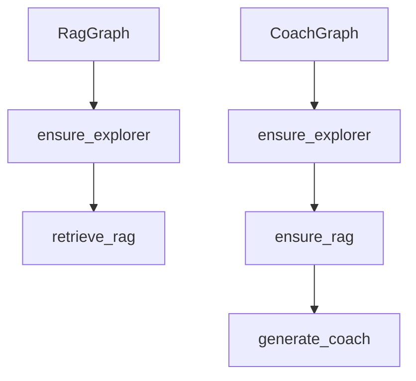

# Architecture cible

L'architecture cible doit servir un POC local, demonstrable et contraint par les sources. Ce document decrit les composants techniques, les flux et les contrats d'API. Les details donnees, UX, planning et risques vivent dans leurs documents dedies.

Documents complementaires :

- `docs/data/README.md` : sources, MongoDB, Milvus, caches et contrats de donnees.
- `docs/UX.md` : interface Angular, composants et layouts.
- `docs/PLAN.md` : ordre de livraison.
- `docs/RISKS.md` : risques, mitigations et escalades.

## Vue d'ensemble

```text
frontend Angular
+-- echiquier interactif
+-- selection du niveau pedagogique
+-- historique des coups
+-- panneau ouverture et coups recommandes
+-- panneau explication coach
+-- panneau statistiques Lichess
+-- panneau evaluation Stockfish
+-- panneau videos ou fallback YouTube

backend FastAPI
+-- API REST + SSE
+-- validation position avec python-chess
+-- orchestration LangGraph (Explorer, RAG et Coach REST)
+-- service openings MongoDB
+-- service Lichess
+-- service RAG Milvus
+-- service Stockfish
+-- service YouTube
+-- scripts d'ingestion et seed

data layer
+-- MongoDB : ouvertures, sessions, analysis_runs et caches API
+-- Milvus : embeddings et chunks pedagogiques
+-- fichiers sources : chess-openings, corpus pedagogique valide

execution locale
+-- docker compose
+-- frontend
+-- backend
+-- mongodb
+-- milvus
+-- dependances Milvus requises
```

## Flux principal d'analyse

1. Le frontend envoie FEN, PGN, coups UCI et niveau pedagogique.
2. FastAPI valide la position avec `python-chess`.
3. LangGraph orchestre les familles Explorer, RAG et Coach REST ; les services imperatifs restent
   responsables de la logique metier, des caches, des fallbacks et de la persistance.
4. Le matching local cherche l'ouverture dans MongoDB.
5. Lichess fournit statistiques et coups populaires filtres par plage de niveau joueur si disponibles.
5a. Masters fournit une vue theorique separee des coups issus de parties de maitres.
6. Le backend persiste un `AnalysisRun` dans la collection MongoDB `analysis_runs` avec les facts et le statut de chaque famille.
7. `POST /api/analyze-position` ne calcule que l'Explorer (ouverture, Lichess, Masters, coups recommandes, videos) et retourne immediatement le `run_id`.
8. Le frontend lance en parallele `POST /api/stockfish/analyze-run` et `POST /api/rag-context` quand leurs panneaux en ont besoin.
9. Le service d'ouvertures construit une fenetre locale dans l'arbre `chess-openings`; Milvus fournit ensuite le contexte pedagogique pertinent.
10. Stockfish est appele uniquement par son endpoint si la theorie est absente, si aucun coup candidat pertinent ne reste, ou si la confiance statistique est faible.
11. `GET /api/analysis-runs/{run_id}/coach/stream` lit les facts persistants et diffuse la synthese coach par SSE; `POST /api/coach-explanation` reste le fallback REST.
12. Chaque famille est idempotente : un resultat `generated`, `fallback` ou `skipped` est relu sans nouvel appel externe.

Le coach recoit le contexte en sections separees : position courante, suites possibles directes, prose principale, coups recommandes, statistiques Lichess, evaluation Stockfish, puis prose sur suites possibles. Une prose issue d'un enfant direct doit rester conditionnelle et attachee a son `entry_move`; elle ne peut pas etre formulee comme etat courant tant que le coup correspondant n'a pas ete joue. Les references interactives de la prose utilisent le DSL documente dans l'ADR 0008 (`move`, `square`, `line`) ; le backend les valide contre la FEN et les faits autorises avant diffusion finale.

## Cycle de vie des clients HTTP

`LichessExplorerClient` et le `LLMProvider` configure sont crees une seule fois dans le `lifespan` FastAPI et stockes dans `app.state`. Ils sont partages par toutes les requetes pour beneficier du pool de connexions HTTPX et d'un timeout dedie au coach (`llm.coach_timeout_seconds`). Le fournisseur de coach utilise un timeout plus court que `llm.timeout_seconds` pour eviter qu'un modele lent ne bloque l'experience utilisateur.

## API minimale

```text
GET /health
POST /api/analyze-position
POST /api/coach-explanation
POST /api/stockfish/analyze-run
POST /api/rag-context
GET /api/analysis-runs/{run_id}/coach/stream
POST /api/stockfish/evaluate
GET /api/openings/{fen_or_epd}
GET /api/videos
POST /api/sessions
GET /api/sessions/{id}
```

Endpoint central :

```http
POST /api/analyze-position
```

Payload minimal :

```json
{
  "fen": "rnbqkbnr/pppppppp/8/8/4P3/8/PPPP1PPP/RNBQKBNR b KQkq - 0 1",
  "pgn": "1. e4",
  "moves": ["e2e4"],
  "level": "debutant"
}
```

Reponse minimale de `POST /api/analyze-position` :

```json
{
  "opening": {
    "eco": "B00",
    "name": "King's Pawn Game",
    "matched": true,
    "source": "lichess-org/chess-openings"
  },
  "recommended_moves": [],
  "masters_moves": [],
  "lichess_stats": {},
  "source_confidence": {},
  "rag_context": [],
  "coach_explanation": "Le coach detaille est en cours de redaction...",
  "coach_status": "pending",
  "run_id": "...",
  "analysis_key": "rnbqkbnr/...|debutant|1000,1200",
  "explorer_status": "generated",
  "stockfish_status": "pending",
  "rag_status": "pending",
  "stockfish": null,
  "videos": [],
  "fallbacks_used": [],
  "session_id": "..."
}
```

`POST /api/stockfish/analyze-run` et `POST /api/rag-context` acceptent `{ "run_id": "..." }` et retournent leur payload avec leur statut. `POST /api/coach-explanation` accepte `{ "run_id": "...", "level": "debutant" }`, lit le run et retourne :

```json
{
  "explanation": "...",
  "coach_status": "generated",
  "fallbacks_used": []
}
```

Le flux SSE du coach utilise les evenements `start`, `token`, `done` et `error`. La generation
LLM Ollama est exposee par le seam `LLMProvider.generate_stream`; une deconnexion remet le statut
coach a `pending`. Une seconde connexion au meme run rejoint la generation en cours dans le
processus FastAPI au lieu de lancer un second appel LLM.

## LangGraph cible

```text
Start
+-- normalize_position
+-- identify_opening
+-- fetch_lichess_stats
+-- retrieve_rag_context
+-- maybe_run_stockfish
+-- fetch_youtube_videos
+-- generate_coach_answer
+-- End
```

Les services sont actuellement testes et appeles de maniere imperative. La cible LangGraph
orchestrera ensuite des services deja stabilises, sans devenir le lieu ou la logique metier est cachee.

Evolution actuelle (ADR 0009) : LangGraph orchestre deja les familles Explorer, RAG et Coach REST
dans un module dedie. Chaque graphe delegue aux services stabilises ; `RagService`, `CoachService`
et les autres services n'importent pas `langgraph`. Les appels progressifs restent pilotes par l'UI
et reutilisent `RunStore`/`CacheStore` dans MongoDB. Stockfish et le streaming coach conservent leur
chemin specialise jusqu'a une migration ulterieure.

### Transition possible : preconditions entre familles

Status: proposed, not implemented.

Le cablage initial conserve des graphes LangGraph par famille et des endpoints progressifs pilotes
par l'UI. Une evolution possible consiste a rendre leurs dependances explicites : `RagGraph` assure
la disponibilite d'Explorer avant le retrieval, et `CoachGraph` assure Explorer puis RAG avant la
synthese coach.



Les noeuds `ensure_*` doivent reutiliser les artefacts `generated`, `fallback` ou `skipped` du
`RunStore`, attendre une famille deja `running`, ou executer uniquement la famille manquante. Cette
transition ne doit pas multiplier les appels externes : Lichess, Milvus et le LLM restent proteges
par les claims atomiques, les caches MongoDB, les statuts de famille et l'idempotence existante.
Cette proposition sera promue dans une ADR ou dans `docs/PLAN.md` uniquement apres validation de
son comportement et de son impact sur le streaming coach.

Milvus standalone (phase 1) : le store est servi soit par **Milvus Lite** (fichier local, dev/tests/harness), soit par **Milvus Standalone** (`docker-compose.yml`) via `MILVUS_URI`. La compose fournit la pile d'infrastructure (MongoDB, Ollama, etcd, MinIO et Milvus) ; le backend et le frontend sont lances separement aujourd'hui. Le provider coach est choisi dans `config.toml` (`nvidia`, `ollama` ou `mistral`) ; les secrets sont `NVIDIA_API_KEY` ou `MISTRAL_API_KEY` selon le choix. Milvus ne contient que de la prose pedagogique ; `chess-openings` est une donnee structuree hors Milvus (ADR 0006).

Retrieval d'ouverture cible : `chess-openings` est l'arbre deterministe de lignes et de suites candidates ; Milvus est le retrieval de prose pedagogique. Le RAG global assemble les deux sans les confondre. Le retrieval Milvus ne doit pas elargir a tous les descendants d'une ouverture ; il utilise une fenetre locale, un budget separe pour les enfants directs et une penalite par distance dans l'arbre pour eviter la pollution par des variantes trop profondes.

Routeur d'intention cible : la classification floue de la question utilisateur peut etre confiee a un modele de decision structuree de type **Jev / System One** (TypeSafe AI) plutot qu'a un LLM generatif. Le routeur ne genere pas la reponse coach et ne choisit pas librement les sources critiques : il retourne une intention typee, des probabilites et une confidence. Le code backend transforme ensuite cette decision en `retrieval_plan` deterministe (`tree_context`, `current_prose`, `candidate_prose`, `general_principles`, `stockfish`). En cas de confidence faible ou d'indisponibilite du routeur, le systeme revient a un plan conservateur rule-based : arbre + prose du noeud courant, sans prose enfant sauf coup explicitement demande. Toute integration Jev reste une dependance externe a valider par ADR/recherche avant implementation.

Option future a revisiter : **`langchain-typesafe`** fournit `TypeSafeClassifier`, un `Runnable`
LangChain qui pourrait remplacer l'appel HTTP `/v1/systemone` et son parsing manuel dans
`JevIntentClassifier`. Cette option doit conserver la seam `IntentClassifier`, `IntentDecision`, le
fallback rule-based et les seuils de confidence actuels. `TypeSafeClassifier` ne doit fournir que la
classification ; le backend continue de construire et de valider le `RetrievalPlan`, les sources,
les budgets et les fallbacks. Ne pas utiliser les middlewares experimentaux
(`ModelRouterMiddleware`, `AutoModeMiddleware`) dans le chemin principal avant validation separee de
LangGraph. Si l'option est retenue, creer un ADR dedie et valider le changement avec
`experiments/rag/eval_v2/routing_ab.py` avant d'activer la dependance dans la configuration de
demonstration. Cette note est une idee differee, pas une dependance ou une decision d'implementation
actuelle.

## Sources de donnees

Les roles precis des sources, de MongoDB, de Milvus et des caches sont definis dans `docs/data/`. L'architecture ne duplique pas ces schemas pour eviter deux sources de verite.

## Fallbacks autorises

| Cible | Fallback autorise | Condition d'activation | Impact |
| --- | --- | --- | --- |
| YouTube API | Lien de recherche YouTube pre-rempli | Cle absente, quota depasse ou delai integration | Videos non enrichies par metadata |
| Lichess API | Donnees seed ou cache MongoDB | `lichess.enabled = false`, `LICHESS_TOKEN` absent, API indisponible, acces non autorise, timeout ou reponse invalide | Stats possiblement non live |
| Milvus | Collection minimale seedee ou reponse RAG vide explicite | Probleme compose ou ingestion incomplete | Coach moins contextualise |
| LLM cloud | Provider compatible OpenAI alternatif ou mock coach source | Cle absente ou cout non valide | Reponse moins naturelle |
| Embeddings local (`Qwen3-Embedding-0.6B`) | Modele local plus leger (`intfloat/multilingual-e5-base`) | Ressources insuffisantes, latence demo trop haute ou echec de telechargement | Qualite de retrieval possiblement moindre |
| Coach LLM configure | `ConservativeCoachService` (template deterministe) avec labels `llm_coach_unavailable`, `llm_coach_timeout`, `llm_coach_empty`, `llm_coach_too_long` ou `llm_coach_source_metadata` | Provider indisponible, modele non disponible, timeout, reponse vide, limite de generation ou metadonnees RAG incompletes | Analyse jamais en echec ; reponse moins naturelle, provenance visible dans les panneaux de donnees |
| Librairie echiquier | Librairie Angular alternative validee | Incompatibilite version ou maintenance | UI adaptee mais Angular conserve |

Un fallback doit etre visible dans la reponse backend via `fallbacks_used` lorsque cela aide a comprendre la qualite de l'analyse.

## Recherche cadree requise

Avant implementation, les sujets suivants doivent etre recherches et valides par ADR ou note de decision :

- Provider LLM.
- Embeddings.
- Sources pedagogiques documentaires.
- Librairie d'echiquier Angular.

La recherche doit comparer au minimum : compatibilite locale, cout, qualite, effort d'integration, risques demo, licences ou conditions d'utilisation.

## Structure de depot cible

```text
backend/
+-- app/
|   +-- api/
|   +-- agents/
|   +-- core/
|   +-- ingestion/
|   +-- models/
|   +-- services/
|   +-- main.py
frontend/
+-- src/
data/
+-- raw/
+-- processed/
docs/
docker-compose.yml
```
