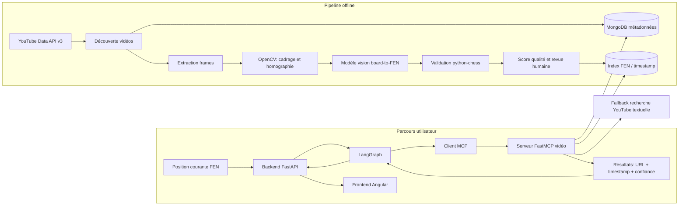

# Note de conception : système MCP de recherche vidéo par position

**Statut :** étude de conception, non implémentée
**Périmètre :** ressources vidéo pédagogiques liées à une position d'échecs
**Produit concerné :** POC Agent d'ouvertures FFE

## 1. Résumé exécutif

La recherche YouTube par nom d'ouverture constitue un premier fallback utile,
mais elle ne garantit pas que la vidéo explique la position actuellement affichée.
Une vidéo de 45 minutes sur la Sicilienne peut par exemple être proposée alors
que le joueur cherche uniquement à comprendre un échange ou un coup précis.

Le système étudié ici ajoute un index spécialisé capable de relier une position
d'échecs à un ou plusieurs passages vidéo. Les vidéos sont découvertes via
l'API YouTube Data v3, puis analysées hors ligne : extraction d'images,
détection de l'échiquier et conversion en FEN. Le résultat est exposé par un
serveur MCP afin que le backend et LangGraph puissent interroger cette capacité
comme un outil borné.

Cette architecture est faisable pour un catalogue réduit de vidéos validées.
Elle n'est pas nécessaire au parcours minimal du POC actuel et ne doit pas
remplacer la recherche YouTube classique tant que la qualité de l'indexation
n'a pas été mesurée.

## 2. Objectifs et périmètre

### Objectifs

- proposer une ressource vidéo associée à la position courante plutôt qu'à la
  seule famille d'ouverture ;
- fournir un lien YouTube avec un timestamp pertinent ;
- conserver la provenance, le niveau de confiance et le type de correspondance ;
- exposer la recherche par une interface MCP indépendante du backend métier ;
- permettre à LangGraph de sélectionner automatiquement la ressource vidéo ;
- conserver un fallback explicite vers une recherche YouTube textuelle.

### Hors périmètre initial

- télécharger ou réhéberger les vidéos YouTube ;
- indexer automatiquement l'ensemble de YouTube ;
- garantir une compréhension parfaite de tous les échiquiers filmés ;
- générer un clip vidéo propriétaire ;
- utiliser la vidéo comme source de vérité pour la légalité d'un coup ;
- remplacer Stockfish, Lichess ou le corpus pédagogique documentaire.

La légalité des coups, l'identification de l'ouverture et les faits de position
restent détenus par les services déterministes du backend.

## 3. Bénéfices attendus

### Bénéfices pédagogiques

- **Pertinence locale :** la vidéo est reliée à la position courante et non
  uniquement au nom de l'ouverture.
- **Réduction de la charge cognitive :** l'élève arrive directement au passage
  utile au lieu de chercher manuellement dans une vidéo longue.
- **Continuité du parcours :** une ressource peut être proposée après chaque
  analyse, au même endroit que les statistiques et l'explication du coach.
- **Progressivité :** le classement peut prendre en compte le niveau
  `debutant`, `intermediaire` ou `avance`.
- **Explication multimodale :** le coach peut associer son explication textuelle
  à une démonstration visuelle externe.

### Bénéfices techniques

- **Découplage :** le serveur MCP encapsule l'index vidéo et son évolution sans
  imposer cette logique aux services FastAPI ou au coach.
- **Réutilisation :** le même outil peut être utilisé par une interface web,
  un agent de démonstration ou un outil d'annotation.
- **Traçabilité :** chaque résultat peut inclure la FEN recherchée, le timestamp,
  le score, la source et la méthode de matching.
- **Réduction des appels live :** l'analyse coûteuse est réalisée à l'ingestion ;
  la recherche courante consulte ensuite un index local.
- **Évolutivité :** l'index peut accueillir ensuite la transcription, les
  chapitres, les thèmes tactiques ou plusieurs variantes d'une position.

## 4. Limites et risques

### Qualité de la reconnaissance

La conversion d'une image en FEN dépend fortement de la résolution, de la
perspective, de l'orientation de l'échiquier, des animations, des pièces
capturées, des incrustations et de la visibilité des cases. Une erreur sur une
seule pièce peut produire une FEN légalement plausible mais incorrecte.

Le système doit donc stocker un score de confiance et distinguer au minimum :

- `exact_fen` : position reconnue et validée ;
- `near_position` : position proche après normalisation ou distance contrôlée ;
- `opening_match` : correspondance par ouverture, sans preuve visuelle de la FEN ;
- `text_search_fallback` : recherche YouTube non indexée.

Une correspondance de faible confiance ne doit pas être présentée comme une
preuve que la vidéo explique exactement la position.

### Couverture limitée

Un index réduit ne couvrira qu'un nombre limité d'ouvertures et de chaînes. Une
absence de résultat ne signifie pas qu'aucune vidéo pertinente n'existe sur
YouTube ; elle signifie seulement que le catalogue indexé n'en contient pas.

### Coûts et latence

L'indexation est plus coûteuse que la recherche textuelle : extraction de frames,
inférence de vision, validation des FEN et stockage des annotations. Elle doit
être asynchrone et hors du chemin critique de l'analyse d'une position.

### Quotas et dépendance YouTube

L'API YouTube Data v3 est soumise à un quota quotidien par projet. La méthode
`search.list` est particulièrement coûteuse en unités de quota, tandis que les
résultats mis en cache évitent les recherches répétées. Les valeurs de quota
doivent être vérifiées dans la console Google du projet avant chiffrage final.

Le système doit limiter les recherches, utiliser le cache et ne jamais relancer
une indexation complète à chaque demande utilisateur.

### Conditions d'utilisation et droits

Le système ne doit pas télécharger, modifier ou redistribuer les vidéos sans
base juridique appropriée. Le périmètre recommandé est de conserver :

- l'identifiant et l'URL YouTube ;
- les métadonnées autorisées ;
- les timestamps ;
- les FEN et scores produits par le pipeline ;
- la date de collecte et la version de l'index.

L'affichage intégré doit respecter les possibilités d'embed et les conditions
de la plateforme. Un lien externe reste le fallback de référence.

## 5. Technologies évaluées

Cette étude ne retient pas une technologie unique comme solution miracle. La
détection d'une position d'échecs dans une vidéo combine plusieurs problèmes :
localiser l'échiquier, corriger la perspective, reconnaître les pièces,
déduire l'orientation, produire une FEN et vérifier que la position est
cohérente avec une partie ou une ouverture.

### OpenCV et vision classique

OpenCV est pertinent pour les premières étapes du pipeline : détection de
contours, lignes, coins, homographie, correction de perspective et suivi entre
frames proches. Les fonctions de calibration et de reconstruction 3D d'OpenCV
documentent les modèles de caméra, la perspective et les transformations
homographiques nécessaires pour rectifier un plan filmé de biais.

Limites : les vidéos YouTube pédagogiques ne montrent pas toujours un échiquier
physique net. Elles peuvent utiliser des overlays, animations, transitions,
thèmes graphiques variés, pièces stylisées, zooms et recadrages. Une approche
OpenCV pure risque donc d'être fragile dès que le rendu sort d'un cas contrôlé.

### Modèles de vision spécialisés

Les modèles de détection d'objet ou de segmentation peuvent localiser
l'échiquier et les pièces avec plus de robustesse qu'une approche par contours.
Un pipeline réaliste sépare généralement :

- détection du plateau ou de ses quatre coins ;
- rectification de l'image en grille 8x8 ;
- classification de chaque case : vide ou pièce ;
- orientation du plateau ;
- conversion en FEN ;
- validation déterministe avec `python-chess`.

Cette option améliore la robustesse mais introduit un coût de dataset,
d'entraînement ou d'intégration d'un modèle existant. Le risque principal est
le faux positif silencieux : une FEN plausible mais fausse peut orienter le
joueur vers un passage vidéo incorrect.

### Transcription et métadonnées YouTube

Les titres, descriptions, chapitres et sous-titres peuvent aider à détecter une
ouverture, une variante ou un thème. Ils ne prouvent pas que la position exacte
est visible au timestamp retourné. Ils sont donc utiles pour le ranking et le
fallback, pas comme source de vérité pour la FEN.

### Annotation humaine contrôlée

Pour un POC, l'option la plus fiable est un catalogue réduit de vidéos validées
manuellement : quelques timestamps associés à des FEN et à des niveaux de
confiance. Cette approche ne démontre pas l'automatisation complète, mais elle
valide le contrat produit : à partir d'une position, le système peut retourner
une ressource vidéo utile, sourcee et bornée.

### Choix recommandé

La trajectoire recommandée est hybride : commencer par un catalogue curé,
exposé via MCP, puis automatiser progressivement l'ingestion. OpenCV peut
servir au cadrage et à la rectification, un modèle vision au board-to-FEN, et
`python-chess` à la validation. La recherche textuelle YouTube reste le fallback
tant que la couverture et la précision ne sont pas mesurées.

## 6. Architecture technique cible



### Composants

| Composant | Responsabilité | Nature |
| --- | --- | --- |
| Découverte YouTube | Rechercher les vidéos par ouverture et mots-clés | Appel externe |
| Extracteur de frames | Échantillonner les images d'une vidéo | Batch asynchrone |
| OpenCV | Cadrage, homographie, rectification et prétraitement | Vision classique |
| Modèle board-to-FEN | Détecter l'échiquier, les pièces et produire une FEN | Vision ML |
| Validateur FEN | Vérifier la syntaxe et la cohérence minimale | Déterministe |
| Revue qualité | Valider ou rejeter les correspondances à fort impact | Humain ou semi-auto |
| Index positions vidéo | Associer FEN, vidéo, timestamp et confiance | MongoDB ou index dédié |
| Serveur FastMCP | Exposer la recherche comme outil borné | Service interne |
| Noeud LangGraph | Appeler MCP selon les résultats Explorer | Orchestration |
| Backend FastAPI | Contrat API, fallbacks et contrôle des sources | Application |
| Frontend Angular | Afficher lien, timestamp et statut | Interface |

### Flux d'ingestion

1. Le pipeline reçoit une ouverture, une liste de vidéos ou une requête YouTube.
2. Il récupère les métadonnées nécessaires sans réhéberger la vidéo.
3. Il extrait des frames à intervalle configurable, par exemple toutes les 5 à
   10 secondes.
4. Le modèle de vision identifie l'échiquier et produit éventuellement une FEN.
5. Le validateur rejette les sorties invalides et attribue un score de confiance.
6. Le pipeline regroupe les occurrences proches afin d'éviter des entrées
   redondantes pour la même séquence.
7. Il persiste les timestamps, FEN, métadonnées, version du modèle et statut de
   validation.

### Flux de recherche

1. Explorer identifie l'ouverture et fournit la FEN courante.
2. LangGraph appelle le service vidéo uniquement si la fonctionnalité est
   activée et si une position exploitable est disponible.
3. MCP recherche d'abord une FEN exacte, puis une position proche selon un seuil
   déterministe.
4. Si aucun résultat fiable n'est trouvé, le service renvoie un résultat vide
   explicite ou délègue au fallback de recherche textuelle.
5. Le frontend affiche le titre, la chaîne, le lien avec timestamp et le niveau
   de confiance. Il ne présente pas le résultat comme une recommandation
   certaine lorsque le matching est approximatif.

## 7. Interface MCP proposée

Le serveur MCP ne décide pas librement des sources critiques. Il expose des
outils spécialisés, avec des paramètres bornés et des résultats structurés.

### `search_video_by_fen`

Entrée :

```json
{
  "fen": "r1bqkbnr/pppp1ppp/2n5/4p3/1b2P3/5N2/PPPP1PPP/RNBQKB1R w KQkq - 2 3",
  "opening_name": "Ruy Lopez",
  "level": "debutant",
  "max_results": 3
}
```

Sortie :

```json
{
  "results": [
    {
      "title": "Ruy Lopez explained",
      "video_id": "abc123",
      "url": "https://www.youtube.com/watch?v=abc123&t=420s",
      "channel_title": "Chess Channel",
      "timestamp_seconds": 420,
      "matched_fen": "r1bqkbnr/pppp1ppp/2n5/4p3/1b2P3/5N2/PPPP1PPP/RNBQKB1R w KQkq - 2 3",
      "confidence": 0.91,
      "match_type": "exact_fen",
      "source": "mcp-video-position-index"
    }
  ],
  "fallbacks_used": []
}
```

### `search_video_by_opening`

Cet outil sert de repli lorsque la FEN n'est pas indexée. Il effectue une
recherche contrôlée par ouverture, niveau et mots-clés, puis retourne des liens
YouTube sans prétendre qu'un timestamp correspond à la position exacte.

### `get_video_index_status`

Outil de diagnostic pour l'interface d'administration ou les tests. Il retourne
la taille du catalogue, la date de dernière indexation, la version du modèle de
vision, le nombre de vidéos en erreur et le taux de couverture par ouverture.
Il ne doit pas exposer de clé API ni de chemins internes sensibles.

### `submit_video_for_indexing`

Outil optionnel, réservé à un usage administrateur. Il accepte un `video_id`
YouTube déjà validé et le place dans une file d'ingestion. Il ne doit pas être
appelé automatiquement par le coach en production : l'indexation est coûteuse,
asynchrone et soumise aux droits et quotas.

### Règles de sécurité et de contrôle

- `max_results` est plafonné côté serveur ;
- la requête ne peut pas demander une exploration illimitée ;
- les résultats sont filtrés sur leur type vidéo et leur identifiant ;
- les URLs sont reconstruites à partir de l'identifiant YouTube validé ;
- aucune donnée secrète ou clé API n'est exposée au modèle ou au frontend ;
- le serveur retourne les raisons de fallback et les scores de confiance.
- les outils d'administration sont protégés par une politique d'accès séparée ;
- les appels MCP ont un timeout court et un résultat vide explicite en cas
  d'indisponibilité.

## 8. Intégration LangGraph

Le noeud LangGraph reste mince et délègue au service MCP. Il ne contient ni
logique de vision, ni accès direct à YouTube, ni logique de persistance.

```text
Start
  -> normalize_position
  -> identify_opening
  -> fetch_lichess_stats
  -> retrieve_rag_context
  -> maybe_run_stockfish
  -> maybe_search_video_mcp
       |-- résultat fiable --> attach_video_resources
       |-- résultat vide ----> youtube_text_fallback
       |-- MCP indisponible -> visible fallback
  -> generate_coach_answer
  -> End
```

Le coach peut mentionner l'existence d'une ressource vidéo, mais il ne doit pas
inventer son contenu. Le titre, la chaîne, le timestamp et le score doivent
provenir du résultat validé.

## 9. Étude de faisabilité

### Faisabilité fonctionnelle

**Évaluation : faisable sous contrainte.** Un POC peut être réalisé sur un
catalogue fermé de 10 à 30 vidéos sélectionnées manuellement et sur quelques
ouvertures de démonstration. Cette approche permet de tester le parcours MCP
sans résoudre immédiatement l'indexation générale de YouTube.

### Faisabilité technique

| Niveau | Périmètre | Résultat attendu |
| --- | --- | --- |
| POC 1 | Métadonnées YouTube + recherche textuelle MCP | Architecture et contrat validés |
| POC 2 | Frames pré-calculées sur 10 vidéos | Premiers timestamps associés à des FEN |
| POC 3 | 30 vidéos, validation manuelle, scores | Démonstration crédible de recherche par position |
| V1 | Pipeline batch automatisé et monitoring | Catalogue maintenable |
| V2 | Matching approximatif, transcription, thèmes | Recherche multimodale avancée |

### Scénarios de réalisation

| Scénario | Description | Faisabilité | Risque |
| --- | --- | --- | --- |
| Catalogue manuel | Timestamps et FEN saisis ou validés à la main sur 10 à 30 vidéos | Élevée | Couverture faible, effort humain |
| Semi-automatique | Extraction frames, OpenCV, modèle vision, revue humaine | Moyenne | Qualité variable, besoin d'évaluation |
| Automatisé large | Découverte YouTube, analyse automatique et ranking sans revue systématique | Faible à moyen terme | Faux positifs, coûts, conformité |

Le scénario recommandé pour une première réalisation est le catalogue manuel
exposé via MCP. Il valide l'expérience utilisateur et l'architecture sans
prendre le risque d'une reconnaissance visuelle non maîtrisée. Le pipeline
semi-automatique devient pertinent uniquement après constitution d'un jeu de
référence et définition de métriques qualité.

### Hypothèse de charge POC

Pour 30 vidéos de 20 minutes, avec une frame toutes les 10 secondes :

- 120 frames par vidéo ;
- environ 3 600 frames au total ;
- une seule analyse par frame, puis stockage des seules détections utiles ;
- recherche utilisateur servie par l'index, sans nouvelle analyse vidéo.

Le nombre de frames dépend fortement de l'intervalle, de la durée et de la
présence de chapitres. Une détection de changement de scène peut réduire le
volume, au prix d'une étape supplémentaire.

### Critères de réussite proposés

- au moins 80 % des positions annotées manuellement sont reconnues avec une FEN
  exploitable sur le jeu de vidéos POC ;
- au moins 70 % des trois premiers résultats sont jugés pertinents par un
  évaluateur humain ;
- un résultat exact contient un timestamp à moins de 10 secondes du passage
  pédagogique ciblé ;
- l'absence de résultat déclenche un fallback visible sans bloquer l'analyse ;
- aucune clé API, vidéo téléchargée ou affirmation non sourcée n'est exposée.

Ces seuils sont des objectifs de validation et non des performances garanties.

## 10. Estimation des coûts

Les montants ci-dessous sont des ordres de grandeur pour cadrer la décision,
pas un devis. Ils dépendent du fournisseur cloud, du modèle de vision, du volume
de vidéos et du quota YouTube effectivement disponible.

### Coûts du POC

| Poste | Hypothèse | Estimation |
| --- | --- | ---: |
| YouTube Data API | Projet Google existant, quota standard, recherches limitées | 0 EUR de licence, quota à surveiller |
| Stockage métadonnées | MongoDB local ou instance existante | 0 à 20 EUR/mois |
| Stockage frames temporaires | Quelques milliers à dizaines de milliers de frames | 0 à 20 EUR/mois |
| Calcul vision local | Machine de développement avec GPU/CPU disponible | 0 EUR de service, coût machine existant |
| Calcul vision cloud | Batch ponctuel si le local est insuffisant | 10 à 100 EUR pour expérimentation |
| Serveur MCP local | Processus Python conteneurisé | inclus dans l'infrastructure POC |
| Développement POC | Contrat, index réduit, tests et démonstration | 3 à 6 jours.homme |

Ce scénario correspond à un livrable démontrable mais volontairement limité. Il
ne promet pas l'indexation automatique de YouTube : il prouve que le produit sait
interroger un outil MCP vidéo et afficher un timestamp fiable lorsque le catalogue
contient la position.

### Coûts d'une première version maintenable

| Poste | Estimation indicative |
| --- | ---: |
| Pipeline ingestion, validation et reprise | 5 à 10 jours.homme |
| Serveur MCP et intégration LangGraph | 2 à 4 jours.homme |
| Frontend, timestamps et états de fallback | 1 à 3 jours.homme |
| Évaluation qualité et annotation | 3 à 7 jours.homme |
| Monitoring, cache et documentation | 2 à 4 jours.homme |
| Total indicatif | 13 à 28 jours.homme |

Pour un catalogue limité, un budget d'exploitation de **20 à 150 EUR par mois**
est plausible hors coût humain, selon l'hébergement et l'utilisation de GPU.
Une indexation fréquente ou un catalogue volumineux peut dépasser largement
ce montant.

### Coûts d'une V1 plus ambitieuse

| Poste | Hypothèse | Estimation indicative |
| --- | --- | ---: |
| Build backend MCP et contrats | FastMCP, outils bornés, tests, sécurité | 4 à 8 jours.homme |
| Pipeline ingestion vidéo | files de jobs, reprise, logs, statuts | 5 à 10 jours.homme |
| Vision board-to-FEN | intégration modèle, OpenCV, validation | 8 à 15 jours.homme |
| Jeux de test et annotation | 100 à 300 positions annotées | 4 à 8 jours.homme |
| UI et UX fallback | affichage confiance, timestamps, erreurs | 2 à 5 jours.homme |
| Monitoring et exploitation | métriques, alertes, quotas, documentation | 2 à 5 jours.homme |
| Total build V1 | hors recherche modèle longue | 25 à 51 jours.homme |

Opex mensuel possible pour une V1 limitée :

| Poste | Hypothèse | Opex mensuel |
| --- | --- | ---: |
| MongoDB ou base managée légère | catalogue et index | 0 à 80 EUR |
| Stockage objets temporaire | frames, rapports d'ingestion | 0 à 50 EUR |
| Compute CPU batch | ingestion ponctuelle | 10 à 100 EUR |
| Compute GPU batch | si modèle vision lourd | 50 à 300 EUR |
| Observabilité | logs et métriques simples | 0 à 50 EUR |
| YouTube Data API | dans quota gratuit, quota à surveiller | 0 EUR direct au POC |
| Total indicatif | selon volume et fréquence | 60 à 580 EUR/mois |

### Quota YouTube

Le coût financier direct de l'API peut être nul dans le quota attribué au projet,
mais le quota est une contrainte opérationnelle. La documentation YouTube Data
API indique que chaque requête consomme du quota, que `videos.list` est peu
coûteux et que `search.list` possède une limite quotidienne dédiée par défaut.
Les recherches doivent donc être mises en cache, dédupliquées et exécutées en
batch. Le chiffrage définitif doit être fait à partir de la console Google du
projet et du nombre réel de requêtes `search.list` et `videos.list`.

## 11. Risques techniques et business

| Risque | Type | Impact | Mitigation |
| --- | --- | --- | --- |
| FEN fausse mais plausible | Technique | Vidéo incorrecte présentée comme pertinente | score, validation, revue humaine, libellé approximatif |
| Détection instable selon le style vidéo | Technique | Couverture faible | catalogue curé, mesure par chaîne, fallback textuel |
| Coût GPU sous-estimé | Technique/opex | budget imprévisible | batch, échantillonnage, limites par vidéo |
| Quota YouTube dépassé | Opérationnel | ingestion bloquée | cache, batch, déduplication, suivi quota |
| Conditions YouTube mal respectées | Business/juridique | risque conformité | stocker métadonnées et timestamps, pas de réhébergement |
| Valeur pédagogique insuffisante | Business | faible adoption | évaluation humaine, feedback utilisateur, catalogue ciblé |
| Maintenance du catalogue | Business/produit | obsolescence ou liens morts | statut d'index, révalidation périodique |

Le risque le plus critique n'est pas le coût d'infrastructure, mais la confiance
utilisateur. Un jeune joueur doit comprendre si la vidéo correspond exactement à
la position, à une variante proche ou seulement à l'ouverture. Le frontend doit
donc afficher le type de correspondance et la confiance, pas seulement un lien.

## 12. Alternatives étudiées

### Alternative A : recherche YouTube textuelle enrichie

Conserver le système actuel : recherche par ouverture, niveau et mots-clés,
cache MongoDB, fallback visible. C'est l'option la moins coûteuse et la plus
fiable à court terme, mais elle ne garantit pas le timestamp ni la position
exacte.

### Alternative B : catalogue curé avec timestamps

Construire un petit catalogue de vidéos pédagogiques validées manuellement,
avec FEN, ouverture, niveau, timestamp et commentaire. Le serveur MCP expose ce
catalogue comme un outil standard. C'est la meilleure option pour démontrer la
valeur produit avec un risque faible.

### Alternative C : automatisation vision complète

Déployer un pipeline board-to-FEN complet avec extraction de frames,
prétraitement OpenCV, modèle vision et indexation automatique. Cette option est
la plus ambitieuse et la plus scalable, mais elle doit être précédée d'un jeu de
référence, d'une mesure de précision et d'un budget d'exploitation validé.

## 13. Plan de développement recommandé

| Phase | Durée indicative | Livrable | Critère go/no-go |
| --- | ---: | --- | --- |
| Phase 0 | 1 à 2 jours | catalogue manuel de 10 vidéos et contrat MCP | résultats utiles sur scénarios demo |
| Phase 1 | 3 à 6 jours | serveur FastMCP + outil `search_video_by_fen` | intégration backend sans casser le fallback |
| Phase 2 | 5 à 10 jours | pipeline ingestion semi-auto et revue humaine | précision FEN mesurée sur jeu annoté |
| Phase 3 | 10 à 20 jours | modèle vision et monitoring qualité | faux positifs critiques sous seuil accepté |
| Phase 4 | continu | extension catalogue et réindexation | coût opex stable et valeur utilisateur validée |

La décision de passer de la phase 1 à la phase 2 doit dépendre d'une mesure
simple : au moins 70 % des résultats retournés dans le top 3 doivent être jugés
utiles par un évaluateur humain sur un jeu de positions représentatif.

## 14. Références utilisées

- Model Context Protocol : standard ouvert pour connecter des applications IA à
  des outils, données et workflows externes.
- FastMCP : framework Python pour exposer des fonctions comme outils MCP avec
  schémas, validation, transport et cycle de vie.
- OpenCV : bibliothèque de vision pour détection de contours, calibration,
  homographies et transformations de perspective.
- YouTube Data API v3 : découverte de vidéos, métadonnées et quotas à suivre
  depuis la console Google Cloud.

## 15. Recommandation de trajectoire

### Pour la démonstration actuelle

Conserver la recherche YouTube textuelle et son fallback visible. Elle est plus
simple, immédiatement compréhensible et suffisante pour montrer l'intégration
vidéo dans le parcours d'ouverture.

### Pour le prototype MCP

Créer un catalogue fermé de vidéos et d'annotations validées manuellement.
Implémenter d'abord `search_video_by_fen` sur des FEN connues, sans chercher à
automatiser tout le pipeline vision. Cette version permet de démontrer le
contrat MCP, le timestamp et l'intégration LangGraph avec un risque limité.

### Pour une évolution produit

Automatiser progressivement l'ingestion, introduire les scores de confiance,
mesurer la pertinence sur un jeu de référence et ne rendre le matching
approximatif visible qu'après validation. Le fallback YouTube textuel doit rester
disponible tant que la couverture et la précision du catalogue ne sont pas
suffisantes.

## 16. Conclusion

Le système MCP d'indexation vidéo par position répond au principal défaut de la
recherche YouTube textuelle : elle ne sait pas localiser le passage utile dans
une vidéo par rapport à la position courante.

Le bénéfice pédagogique attendu est important, mais il dépend directement de
la qualité du pipeline board-to-FEN et de la sélection des vidéos. La solution
est donc pertinente comme évolution stratégique et comme démonstrateur sur un
catalogue réduit, mais disproportionnée pour une première intégration YouTube
générique.

La recommandation est de séparer clairement les deux niveaux :

- **solution immédiate :** recherche YouTube classique, cache et fallback ;
- **solution avancée :** serveur MCP, index FEN/timestamp et ressources vidéo
  validées par position.
